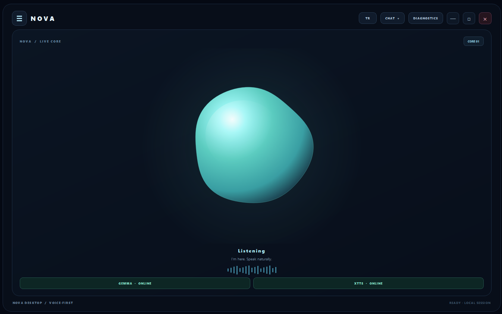
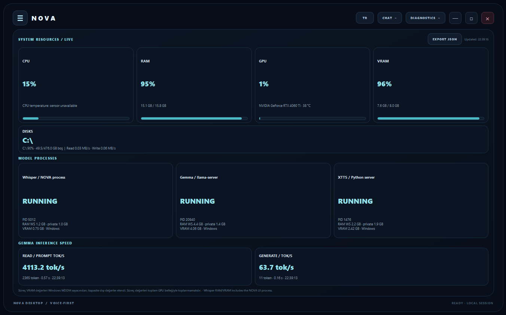

# NOVA — Neural Orchestrator for Voice Assistance

**A local-first Windows voice assistant combining Whisper, Gemma 4, llama.cpp, XTTS-v2, system monitoring, and allowlisted desktop actions.**

> **Release:** `v0.1.0` — initial public preview. This tag is the intended release label; create/push the Git tag only after reviewing the final repository and release archive.
>
> **Language:** Turkish is the primary and currently verified language. Other languages may need prompt, function-calling/tool-routing, and speech-language configuration changes.

## Overview

NOVA runs its main language model locally through `llama-server`, transcribes speech with faster-whisper, and produces spoken responses with XTTS-v2. It includes an allowlisted action dispatcher, system-resource monitoring, path discovery, cache reuse, and setup diagnostics.

After models and dependencies have been downloaded, core inference can run locally. Installation and optional web-search features may contact external services. See [Security and Privacy](docs/security-and-privacy.md) and the relevant model documentation.

## Features

- **Voice conversation:** microphone input → Whisper transcription → Gemma response → XTTS spoken output.
- **Local LLM:** Gemma 4 E4B Instruct, GGUF `Q4_K_M`, served by `llama-server`.
- **Function calling / tool actions:** routes supported requests to an allowlisted local action dispatcher, including selected app, browser, audio, system-information, and file actions. The available action set is defined by the installed code and configuration.
- **Web search:** an optional/experimental search path can retrieve online information. Search availability and routing depend on the configured implementation; external requests are not local-only.
- **System-resource monitoring:** CPU, RAM, GPU/VRAM, disk, and temperature views where the relevant telemetry source is available.
- **Speech stack:** faster-whisper for speech-to-text and XTTS-v2 for speech synthesis.
- **Automatic path discovery:** detects known `llama-server.exe` locations and supports optional custom paths through `nova_paths.bat`.
- **Cache-aware installation:** reuses existing compatible model caches and recognized server installations instead of needlessly downloading everything again.
- **Diagnostics:** dry-run inventory plus CUDA/PyTorch, Whisper DLL/model-load, and model-server smoke tests.
- **Experimental / unverified controls:** Wi-Fi and Bluetooth-related actions are untested across hardware and Windows configurations. Treat them as experimental, not guaranteed functionality.

## Screenshots

### Main interface

### Live system resources and model processes

These screenshots are captured from the running NOVA application. Resource values are live readings from the capture moment and should not be treated as fixed performance guarantees.

## Tested systems and performance

**Primary system verified; additional systems under testing.**

| System | Hardware / settings | Gemma 4 E4B Q4_K_M | Status |
|---|---|---:|---|
| Primary desktop | Intel Core i5-14400F · NVIDIA RTX 4060 Ti 8 GB · 16 GB RAM | **66.02 tok/s** | Verified |
| Secondary desktop | AMD Ryzen 5 7500F · NVIDIA RTX 5060 8 GB · 16 GB RAM | Not published | Testing |
| Laptop test | Intel Core i5-11400H · NVIDIA RTX 3050 · 16 GB RAM; 2K context, `--flash-attn`, approx. 10–20% model offload to system RAM/CPU | **16 tok/s** | Tested |

Performance depends on GPU, driver, quantization, context length, Flash Attention, and the proportion of model layers offloaded to system RAM/CPU. Results from different settings are not directly comparable. The laptop figure uses different settings and should not be treated as a like-for-like comparison with the desktop result.

## Language support

**Turkish is the primary and currently verified language of NOVA.** Whisper and XTTS-v2 have multilingual capabilities, but model-level language support does not guarantee that every NOVA feature works equally well in every language.

To adapt NOVA to another language, you may need to modify:

- System prompts and response instructions.
- Function-calling prompts, tool descriptions, and tool-routing logic.
- Whisper transcription language settings and XTTS language codes.
- Language-specific text processing and output formatting.

Other languages may require additional configuration and testing. Contributions that improve multilingual support are welcome.

- [Whisper — official repository and language documentation](https://github.com/openai/whisper)
- [faster-whisper — official repository](https://github.com/SYSTRAN/faster-whisper)
- [XTTS-v2 — model documentation and supported languages](https://docs.coqui.ai/en/latest/models/xtts.html)

## Memory and privacy

NOVA may store conversation history and long-term memory locally. Before public release, users should review the configured database location and backup/delete behavior for their own installation. Do not publish conversation databases, recordings, or personal memory files. Database backup, restore, and deletion workflows should be validated against the exact build before relying on them.

## Experimental and unverified features

Wi-Fi and Bluetooth control paths are **untested**. Their availability and behavior can vary by Windows version, device drivers, adapter hardware, permissions, and the action implementation. They are documented for transparency, not as a guarantee of working support. Contributions and reproducible tests are welcome.

## Requirements

- Windows 10/11, 64-bit.
- Python 3.11 x64 and Python Launcher (`py.exe`).
- NVIDIA GPU and a compatible NVIDIA driver for the currently tested CUDA path.
- Internet access during initial setup to download missing packages and model assets.
- Sufficient free disk space for Python environments, model files, and speech assets.

The TTS environment pins PyTorch/torchaudio CUDA 12.6 wheels. `llama-server` uses a compatible prebuilt CUDA 12.x release. These components can use different CUDA runtime packaging; a driver update is not required solely to make their version numbers match. Actual compatibility depends on the GPU driver and must be confirmed by the installer smoke tests.

### Estimated VRAM guidance — Gemma 4 E4B GGUF

Planning estimates for mostly/full GPU offload; not guarantees. Actual memory use varies with GGUF build, context length, KV-cache settings, backend, and other GPU workloads.

| Quantization | Estimated VRAM budget | Practical guidance |
|---|---:|---|
| `Q4_K_M` | 6–8 GB | Recommended starting point for 8 GB GPUs; shorter context may be needed. |
| `Q5_K_M` | 7–9 GB | More memory than Q4; 8 GB cards may need shorter context or partial offload. |
| `Q6_K` | 8–10 GB | Prefer 10 GB or more for comfortable full offload. |
| `Q8_0` | 10–12+ GB | Prefer 12 GB or more, especially with longer context. |

**Context length:** Reducing it can lower memory use and improve speed, but leaves less room for conversation history and long inputs, which may hurt answer quality on complex tasks. Context length is not the same as maximum generated-answer length; output limits are configured separately.

## Installation

1. Extract the repository to a writable folder.
2. Run `Test-NOVA-DryRun.bat` to inspect the machine and the hypothetical install plan without downloading or changing runtime files.
3. Install Python 3.11 x64 and ensure the NVIDIA driver is installed.
4. Run `Install-NOVA.bat` and let the installer complete its model-server and dependency checks.
5. Run `Start-NOVA.bat`.
6. Test the complete microphone → Whisper → Gemma → XTTS loop.

The installer checks for an existing `llama-server.exe` and the Gemma cache first. Existing compatible components are reused; missing components are downloaded as needed. It does not install Ollama or a standalone CUDA Toolkit.

See [Installation](docs/installation.md), [Configuration](docs/configuration.md), and [Troubleshooting](docs/troubleshooting.md).

## License and third-party models

- **NOVA source code:** MIT License — see [`LICENSE`](LICENSE).
- **Third-party software:** see [`THIRD_PARTY_NOTICES.md`](THIRD_PARTY_NOTICES.md).
- **Model weights and model terms:** see [`MODEL_LICENSES.md`](MODEL_LICENSES.md).

**Important:** XTTS-v2 is licensed under the Coqui Public Model License (CPML), which permits non-commercial use only for the model and its outputs. NOVA's MIT license does not change that restriction. Review all applicable model and dependency terms before commercial use or redistribution.

## Release

The intended initial release tag is **`v0.1.0`**. Release notes are in [`RELEASE_NOTES_v0.1.0.md`](RELEASE_NOTES_v0.1.0.md). Create and publish the tag after reviewing the final repository, confirming third-party license notices, and checking the release archive. The screenshots in this repository are captures from the running application.

## Contributing and security

Bug reports, reproducible install logs, and focused improvements are welcome. Please redact local paths and personal information from logs. Never commit API keys, tokens, credentials, recordings, databases, model weights, caches, or virtual environments. See [CONTRIBUTING.md](CONTRIBUTING.md) and [SECURITY.md](SECURITY.md).
